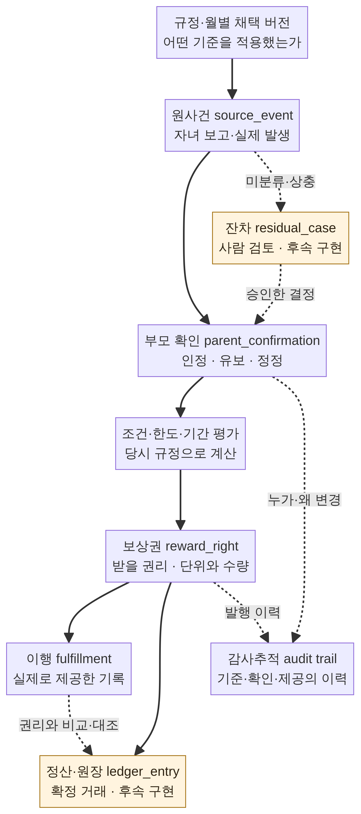
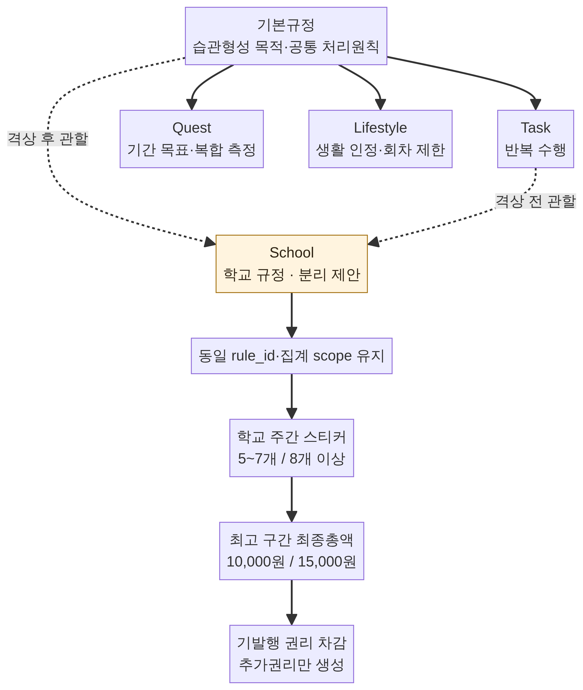
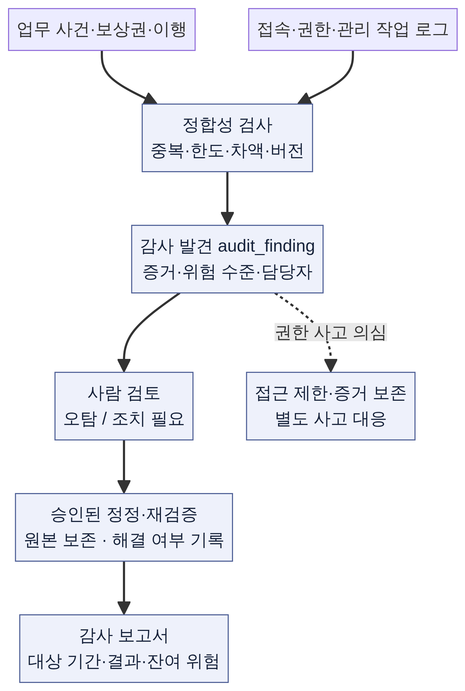

# Play Routine 데이터 기획안
## 규정·행동 사실·부모 확인·보상 결과를 연결하는 설명 가능한 가족 습관 데이터 서비스

**작성:** Manus AI · **기준일:** 2026-10-17 · **문서 상태:** 지원사업 설명·기술 검토용 v0.1

Play Routine은 아이의 행동을 단순 점수로 축약하는 서비스가 아니라, **어떤 규정에 따라 어떤 사실을 부모가 인정했고 어떤 결과가 발생했는지를 연결해 설명하는 서비스**로 기획한다. 반복되는 학습과 생활습관을 관리하면서 부모가 늦게 확인하거나 규칙을 바꾸더라도, 과거의 사실과 보상 근거가 뒤섞이지 않게 하는 것이 핵심이다.

이 문서는 데이터바우처 등 데이터 구축·가공 지원사업을 설명하는 기획 자료로 사용할 수 있도록 작성했다. 특정 공고의 신청 자격·예산·평가항목을 충족한다고 판단한 문서는 아니다. 신청 시에는 해당 공고와 수요기업의 활용 목적에 맞춰 사업 범위와 제출 양식을 확정해야 한다.

## 1. 해결하려는 데이터 문제

기존의 체크리스트에서는 ‘아이가 했다고 표시한 것’, ‘부모가 확인한 것’, ‘보상을 받을 자격’, ‘실제로 보상을 제공한 것’이 같은 칸이나 잔액에 섞이기 쉽다. 부모가 다음 날 확인하면 과거 일별 값과 현재 잔액이 동시에 바뀌어, 왜 결과가 달라졌는지 설명하기 어려워진다.

또한 하루 세 번까지 인정하는 생활습관을 네 번 기록했을 때, 네 번째 행동 자체를 지우는 방식은 실제 수행 기록을 손상시킨다. 반대로 네 번을 모두 보상하면 인정 한도가 작동하지 않는다. 학교 스티커가 주간 5개에서 8개로 늘었을 때도, 기본 보상과 상위 보상을 더해 지급하면 약속한 최종총액을 초과한다.

따라서 이 사업의 데이터 처리 단위는 ‘오늘 점수 한 칸’이 아니라 **규정 버전 → 실제 사건 → 부모 확인 → 조건 평가 → 결과**의 연결이다. 부모에게는 단순한 운영표를 제공하고, 그 뒤의 DB는 변경 근거와 계산 경로를 보존한다. 데이터 구조의 복잡성을 사용자의 반복 입력으로 전가하지 않는다.

## 2. 구축·가공할 데이터와 활용 목적

### 2.1 규정 데이터

기본규정은 습관형성 목적과 보상·중간지대·패널티의 의미를 정의한다. Task는 반복 수행, Quest는 기간 목표와 복합 평가, Lifestyle은 부모가 인정하는 생활행동을 다룬다. 여기서 ‘법령형’은 서비스 내부 규정의 계층과 개정 방식에 대한 표현이며 국가 법률이 아니다.

규정 원문을 구조화할 때는 활동명뿐 아니라 인정 조건, 적용 기간, 횟수 한도, 보상 단위, 배타 관계를 분리한다. **Entity는 독립적으로 식별하고 관리할 데이터 대상**, **Relationship은 대상 사이의 연결**이다. ‘학교 주간 규칙’과 ‘해당 주의 스티커 합계’는 다른 Entity이며, 어떤 규칙에 따라 합산했는지가 Relationship이다.

2026년 10월 검토본에는 Quest 3개, Task 7개, Lifestyle 16개로 총 26개 규칙 번호가 있다. 이는 원문을 구조화한 범위이지, 26개 규칙 모두의 운영 승인과 자동 계산이 완료됐다는 뜻은 아니다. 바이올린 보상처럼 미기재인 값은 `NULL` 또는 `pending`으로 남기며 0으로 바꾸지 않는다.

### 2.2 행동·확인 데이터

`source_event`는 수행이나 위반에 관한 원사건이다. 실제 발생 시각, 시스템 입력 시각, 기록한 주체, 적용 회차를 구분한다. `parent_confirmation`은 부모가 원사건을 인정·미인정·유보·정정한 기록이다. 자녀가 체크했다는 사실만으로 보상 또는 위반을 확정하지 않는다.

학교의 문제 없음과 칭찬은 원천이 다른 사실로 기록한다. 생활습관은 매번 복잡한 점수표를 채우기보다 부모가 수행 인정 여부를 판단하는 구조로 둔다. 다만 패널티, 예외, 과거 정정은 나중에 설명할 수 있도록 필요한 근거를 남긴다. 기록 누락은 실패도 중립도 아니다.

### 2.3 보상·이행 데이터

`reward_right`는 약속에 따라 발생한 **보상을 받을 권리**, `fulfillment`는 그 권리를 **실제로 제공한 기록**이다. 시간 쿠폰, 현금, 쿠페이머니, 소원·체험은 자산과 제공 방식이 다르다. 숫자가 같다는 이유로 합산하거나 자동 환산하지 않는다.

한 달성 조건에는 보상 1개 또는 2개를 연결할 수 있으며 두 번째 보상은 선택이다. 하나의 수행을 인정하고 시간과 현금을 각각 연결하는 것은 가능하지만, 두 보상이 있다는 이유로 수행 횟수나 한도를 두 번 소비해서는 안 된다.

### 2.4 데이터 가공 결과물

구축 결과는 규정 원문과 구조화 조건의 대응 자료, Entity·Relationship 사전, 버전 계보, 가족별 수행·확인 사건, 기간별 인정 결과, 보상권과 이행 기록, 감사 추적 자료로 구성한다. 이를 부모 운영표와 자녀 상태 화면, 부모 전용 CSV, 내부 품질 점검에 활용한다.

지원사업의 데이터 가공 대상은 원문 정규화, 유형 분류, 단위·기간 정합성 검사, 관계 연결, 계산 재현, 개인정보 최소화로 구체화한다. 실제 아동 기록을 공개 데이터셋이나 판매 가능한 자료로 전제하지 않는다. 연구·외부 제공은 별도 목적과 법적 근거를 확인해야 한다.

## 3. 관계형 데이터 구조

**RDB는 관계형 데이터베이스**로, 서로 연결된 데이터를 표와 키로 관리한다. Play Routine은 Supabase의 PostgreSQL을 정본 DB로 유지하는 방향이다. PostgreSQL의 **PK, Primary Key**는 한 행의 고유 식별자이고, **FK, Foreign Key**는 다른 행과의 연결을 검증하는 키이다. 복합 FK를 사용하면 자녀·규칙·보상 사이의 연결이 같은 가족에 속하는지도 검사할 수 있다.[1]

### 3.1 가족과 권한

`families`, `family_memberships`, `children` 또는 현행 `child_profiles`는 가족과 구성원 관계를 나타낸다. 부모는 자기 가족의 규정과 확인을 관리하고, 자녀는 자기 기록을 보며, 조회 전용 보호자는 허용된 상태만 본다. 현재 한 부모가 사용하더라도 DB를 특정 부모 한 명의 ID로 고정하지 않는다.

### 3.2 규정 정체성과 버전

`regulations`와 `rule_identities`는 규정·개별 규칙의 변하지 않는 정체성이다. `regulation_versions`, `rule_versions`는 특정 시점의 내용과 조건이다. **Versioning은 변경 전후를 독립 버전으로 보존하는 방식**이다. 이름과 번호를 바꾸더라도 이미 발생한 사건은 당시 버전을 참조한다.

`regulation_version_relationships`, `rule_governing_versions`, `version_compatibilities`는 상위 근거와 하위 규칙, 검토한 호환 관계를 연결한다. Task·Quest·Lifestyle은 초기 규정 영역이지 영구적인 세 종류 제한이 아니다. School을 독립 영역으로 격상하려면 현재 설계의 종류 제약과 처리기·UI도 함께 보강해야 한다.

### 3.3 월별 채택과 일정

`monthly_plans`와 `plan_rule_adoptions`는 이번 달에 어떤 승인 버전을 누구에게 적용하는지 나타낸다. 다음 달에는 규칙 전문을 복사하기보다 변경 없는 버전을 다시 참조한다. `recurrence_templates`는 격주 같은 반복 원칙, `scheduled_occurrences`는 실제 확정된 수업 회차이다. 미확정 수업을 수업 없음으로 판단하지 않는다.

### 3.4 조건·스티커·한도

`rule_conditions`와 `rule_effects`는 달성 조건과 결과를 분리한다. `sticker_types`, `sticker_awards`는 스티커의 종류와 발생 근거를 담는다. 그림이 같더라도 학교 스티커와 생활습관 스티커를 자동 합산하지 않는다. **아이콘은 표시 자원이고, 계산 정체성은 규칙·자녀·회차·부모 확인의 연결**이다.

`stable_rule_scopes`, `aggregation_periods`는 집계의 안정된 범위와 기간이다. `recognition_limit_buckets`, `recognition_limit_uses`는 인정 한도와 사용 횟수이다. 월별 계획이나 규칙 버전이 바뀌었다고 같은 주의 누계나 같은 날의 한도를 다시 시작하지 않는다.

### 3.5 권리·이행·원장·잔차

`reward_rights`, `reward_correction_events`, `actual_reward_executions`는 보상권과 정정, 실제 제공을 분리한다. **Ledger는 확정 거래를 축적하는 원장**이다. 운영용 불변 원장은 아직 후속 구현 대상이며, 설계 예시의 `immutable_ledger_entries`를 실제 잔액 정산 시스템이라고 설명하지 않는다.

`residual_case`는 분류되지 않았거나 상충하는 사건을 담는 제안 Entity다. 잔차는 새로운 승인 종류가 아니라 사람이 판단해야 하는 상태이다. 미확인, 명시 중립, 조건 미달, 잔차를 하나의 ‘아무것도 없음’으로 합치지 않는다.



*그림 1. 보상권 발생과 실제 제공을 분리한다. 노란 영역은 운영에 아직 연결하지 않은 후속 설계다. 이행 기록이 있어야만 권리나 모든 원장 거래가 생긴다는 뜻은 아니다.*

## 4. 10월 규칙을 적용한 계산 예시

### 4.1 생활습관: 실제 4회, 보상 인정 3회

고양이 화장실 치우기의 명시 조건은 1회 +15분, 하루 최대 3회 인정이다. 부모가 같은 날 네 번 수행을 인정하더라도 실제 사건 네 건은 모두 남기고, 보상 인정만 세 건으로 제한한다. 인정 결과는 총 45분이며 네 번째 사건은 ‘한도 초과·추가 보상 없음’으로 설명한다.

한도는 가족·자녀·안정된 규칙 범위·업무일을 기준으로 관리한다. **Transaction은 여러 DB 변경을 함께 성공시키거나 함께 취소하는 처리 단위**다. 한도 조회와 소비, 인정 결과 저장을 짧은 Transaction으로 묶고 같은 한도 행을 잠근다. **Idempotency, 멱등성**은 같은 요청이 재전송돼도 인정과 보상을 한 번만 처리하는 성질이다. 동일 요청키에 다른 내용이 오면 재사용을 거절한다.[2]

이 예시는 전체 생활습관 보상의 하루 상한을 임의로 정한 것이 아니다. 개별 활동의 명시 한도만 적용한다. 현재 설계 RPC의 자동 생활 인정은 구현한 단일 조건 범위에 한정되며, 모든 사용자 정의 수식을 실행하는 엔진은 아니다.

### 4.2 학교: 최고 구간의 최종총액

사용자가 확정한 학교 주간 보상은 확인된 스티커 0~4개일 때 없음, 5~7개일 때 쿠페이머니 10,000원, 8개 이상일 때 총 15,000원이다. 8개가 됐다고 10,000원과 15,000원을 더해 25,000원을 주지 않는다.

```text
목표 권리총액 = 최고 충족 구간의 최종총액
추가 발행권리 = max(0, 목표 권리총액 - 기존 유효 순발행권리)
미이행액 = max(0, 유효 권리총액 - 실제 순이행액)
```

이미 10,000원 권리가 발생한 뒤 같은 주에 8개가 되면 추가 권리는 5,000원이다. 기존 10,000원을 아직 제공하지 않았다면 총 미이행액은 15,000원이고, 이미 제공했다면 남은 미이행액은 5,000원이다. 발행권리와 그 이행을 같은 계산에서 두 번 빼지 않는다.

미확인 학교 기록은 0개로 바꾸지 않는다. 최종 마감은 필요한 확인이 끝났는지 검사한다. 주간 경계와 일반적인 중간 제공 허용은 별도 승인할 운영 명세이며, 시험에 사용한 주간 날짜를 실제 정책으로 확정하지 않는다.

### 4.3 Quest와 패널티: 같은 데이터라도 다른 결과

기탄 월간 목표의 명시 보상은 미디어쿠폰 300분과 현금 50,000원이다. 같은 달성에 연결된 두 자산을 각각 보존하며 시간을 현금으로 환산하지 않는다. 일별 학습 수행 보상과 월간 시험 통과 보상은 별도 성취이고, 일별 수행이 월간 통과의 자격 요건인지는 별도 관계로 정한다.

패널티는 부모가 실제 위반을 확인하고 승인한 사건에서만 발생한다. 입력 공란이나 선생님 피드백 미수신에서 위반을 추정하지 않는다. 일반 기물파손과 기기파손처럼 같은 사건에 겹치는 규칙은 배타 적용 여부를 명시해야 하며, 아직 확정하지 않은 중복 차감 관계를 임의로 계산하지 않는다.

복약·건강 관찰 기록은 별도 목적과 권한으로 관리한다. 사용자가 유지한 L-013은 부모가 직접 확인한 저녁 생활약속 사건으로 다루며, 약물 기록이나 양육일기의 공란을 자동 차감 근거로 쓰지 않는다. 서비스는 약의 의료적 적정성이나 치료 효과를 판단하지 않는다.

## 5. 규정 격상과 AI 검토

School이 Task 아래에서 별도의 관리 목적을 갖게 되면 Task와 동등한 영역으로 분리할 수 있다. 이때 바꾸는 것은 **GOVERNS, 관할 관계**다. 규칙 ID, 학교 스티커 집계 범위, 이미 열려 있는 기간과 발생 권리는 원칙적으로 유지한다. 관계가 이동했다는 이유만으로 보상을 다시 발행하지 않는다.

PostgreSQL의 **Recursive Query, 재귀 쿼리**는 부모 관계를 따라 여러 층의 규정 경로를 조회할 수 있다. 현재 규모의 규정 트리 때문에 그래프 DB로 즉시 교체할 필요는 없다. 다만 재귀 조회의 순환 표시만으로 잘못된 관계 입력과 경쟁 승인이 자동 차단되는 것은 아니다. 운영 적용 시에는 순환·복수 관할·효력 겹침을 승인 Transaction에서 검사해야 한다.[3]



*그림 2. 점선은 격상 전후의 대안 관할이다. School이 동시에 두 상위에 소속된다는 뜻이 아니다. 실제 보상 영향 검토가 끝나기 전에는 ‘영향 없음’으로 승인하지 않는다.*

Manus는 원문을 정리하고 관계·계산·변경 영향을 1차 검토한다. Grok은 익명화한 스키마와 근거를 실제로 받아 2차 의견을 제시한다. 응답 모델, 입력 파일 해시, 완결 여부와 검토 원문을 보존한다. 후속 수정본을 해당 모델이 다시 검토하지 않았다면 재승인을 받은 것으로 표시하지 않는다.

AI는 변경 후보를 제안할 뿐 부모 승인자가 아니다. 제안에는 전후 관할, 제안 이유와 반론, 보상 영향 상태, 시행 후보일을 보여준다. 부모의 ‘검토·나중에·기각’과 최종 승인을 구분하며 읽음 표시를 승인으로 처리하지 않는다. 자동 격상, 자동 차감, 자동 외부 지급은 이 기획의 기본 동작이 아니다.

## 6. 부모 운영표와 자녀 화면

부모의 상단 메뉴는 **운영표 / 규정 / 보상·원장 / 강화물 / 설정·기록**으로 나눈다. 메뉴는 서로 다른 DB를 만드는 단위가 아니라, 같은 관계형 데이터를 목적별로 조회하는 화면이다. 운영표의 해당 결과를 클릭하면 규정 버전과 부모 확인, 보상 근거로 이동할 수 있게 설계한다.

운영표는 일·주·월과 자녀 범위로 정렬한다. 정상 수행은 부모가 명시적으로 선택한 항목을 일괄 확인하고, 패널티·충돌·소급 정정만 상세 근거를 요구하는 방향이다. **Projection은 사건 이력에서 만든 현재 상태 조회 결과**로, 화면은 이를 읽지만 정정 근거인 원사건을 지우지 않는다.

강화물은 재사용 카탈로그다. 이미 등록된 항목을 태그로 선택하고 활동마다 다시 입력하지 않는다. 계정 연결·조회 보호자·CSV는 설정으로 옮겨 매일 확인 화면의 스크롤을 줄인다. DB의 가족 범위와 요청키는 시스템이 처리하므로 부모가 직접 입력할 필요가 없다.

자녀 화면은 자기 할 일, 확인 대기, 인정 결과, 보상 설명을 중심으로 유지한다. 부모의 구조 변경 제안, 상세 감사로그, 다른 가족 데이터나 민감한 약물 관찰은 상태 화면에 자동 노출하지 않는다. **현재 상단 메뉴·26개 규칙을 담은 새 운영표는 독립 모의 프로토타입이며 운영 DB에 연결하지 않았다.**

## 7. 감사로그 구현 계획

### 7.1 이미 있는 기록과 추가할 기록

**Audit Log는 누가 언제 어떤 작업을 했는지 남기는 감사 기록**, **Audit Trail은 여러 기록을 연결해 한 처리의 경로를 재구성하는 감사 추적**이다. 요청·확인·권리·이행의 연결을 보존해야 계산 결과를 설명할 수 있다.

현행 운영용 migration 소스에는 `invitation_delivery_events`, `auth_link_events`, `routine_occurrence_events`, `routine_entitlement_events`, `routine_request_events`가 있다. 초대 발송·연결·자녀 신고·부모 확인·보상권·요청 재처리의 일부 근거를 기록하고, 주요 루틴 사건 표의 UPDATE·DELETE를 막는 트리거가 있다. 이는 모든 거절 시도·관리자 작업을 포괄하는 통합 감사시스템이 완료됐다는 뜻은 아니다.

신규 `governance_proposals`, `governance_proposal_events`, `governance_change_sets`는 격상·격하 제안, 승인, 적용 또는 실패를 기록할 계획 Entity다. 기존 수신자별 `notifications`와 연결하되, 단순 알림 테이블을 승인 정본으로 사용하지 않는다. 현재 운영 DB에 이 신규 표들이 배포됐다고 설명하지 않는다.

### 7.2 공통 감사 이벤트의 필드

공통 `audit_event`에는 사건 ID, 서버 기록 시각, 가족·행위자·대상 ID, 작업 유형, 성공·거절·실패 코드, 규정과 처리기 버전, 사유 분류를 둔다. **Correlation ID는 한 요청에서 이어지는 여러 처리 기록을 묶는 식별자**다. 요청키와 함께 보관해 중복 처리와 누락을 추적한다.

변경 전후에는 민감한 원문 전체를 복사하기보다 대상 버전과 승인 입력의 **Snapshot, 당시 상태를 고정한 사본** 참조를 남긴다. **Hash는 같은 내용을 같은 요약값으로 바꾸어 비교하는 값**이다. 정규화한 입력의 해시와 Snapshot 해시로 검토한 내용과 승인한 내용이 같은지 대조한다. 규정 개정·승인·효력 시작과 실제 적용 시각도 구분한다.

로그 필드에 비밀번호, 인증 URL, access token, refresh token, API 비밀키를 넣지 않는다. 행동·건강 자유서술은 최소한의 제한 열람 원문에 두고, 공개 분석과 일반 운영 로그에는 포함하지 않는다. 동일한 진료·행동 내용을 로그마다 복제하는 방식을 피한다.

### 7.3 성공 기록과 실패 시도 기록

성공 처리의 권한 확인, 잠금, revision 대조, 상태 변경, 사건·감사 기록, 응답 저장은 한 Transaction 안에서 처리한다. **Revision은 같은 상태를 다른 창에서 변경했는지 확인하는 수정 번호**다. 승인 직전에 근거가 바뀌었다면 재검토하고, 일부 상태만 바뀐 채 성공으로 남기지 않는다.

거절·오류가 발생해 Transaction이 rollback되면 그 안에 기록한 실패 로그도 함께 사라질 수 있다. 따라서 실패 시도는 API 진입 계층이나 별도 제한 권한의 로깅 경로에서 독립적으로 남기도록 개발한다. 작업 유형, 오류 코드, Correlation ID, 필요한 가명 식별값만 기록하고 원문 인증정보와 payload는 제외한다. 실패 로그는 ‘업무 변경이 있었다’는 증거가 아니라 ‘처리를 시도했으나 실패했다’는 관측이다.

**pgAudit은 PostgreSQL에서 DB 명령의 실행 이력을 기록하는 확장**이다. SQL 접근 감사에 도움이 되지만 부모가 어떤 약속을 왜 수정했는지는 업무 이벤트에서 설명해야 한다. 업무 감사로그, 보안 접속기록, pgAudit을 서로 대체하지 않는다. pgAudit은 필요한 역할·명령·보존 범위를 정해 적용하는 후속 과제이며 현재 활성화 완료를 주장하지 않는다.[4]

### 7.4 원본 보존과 위변조 탐지

**Append-only는 원본 행을 덮어쓰거나 지우지 않고 새 사건을 추가하는 방식**이다. 잘못된 부모 확인, 보상권 정정, 원장 조정은 원기록을 참조하는 추가 사건으로 남긴다. 원장 금액을 직접 수정하고 이유만 메모하는 방식은 사용하지 않는다.

향후 **Hash Chain은 앞 사건의 해시를 다음 사건에 연결해 순서·본문 변경을 점검하는 구조**로 검토한다. 그러나 DB 관리자에게 표와 트리거, 해시를 모두 바꿀 권한이 있다면 체인 전체를 다시 만들 수 있다. ‘관리자도 조작 불가능’이라고 주장하지 않는다.

신뢰를 높이려면 분리된 권한의 체크포인트나 서명, 외부 변경 제한 저장소와 대조하는 방식이 필요하다. 현재 외부 체크포인트·서명 체인이 구현된 근거는 없다. 해시는 암호화나 익명화의 동의어도 아니다. 개인정보 보존·파기와 감사 증거의 최소 보존을 함께 설계한다.[5]

## 8. 내부 감사 운영 방식

내부 감사는 로그를 쌓는 기능과 다르다. 무엇을 검사했는지, 어떤 이상을 발견했는지, 누가 판단하고 조치했는지, 다시 검사했는지를 남기는 운영 절차이다. 현재 한 부모·운영자가 자신의 데이터를 점검하면 **자기점검**이다. 외부인이 검증하는 독립감사로 표현하지 않는다.



*그림 3. 감사 발견은 바로 패널티나 데이터 삭제를 명령하지 않는다. 담당자가 증거를 검토하고 승인된 정정·보안 조치를 수행한 뒤 결과를 다시 확인한다. 정기 점검과 발견 관리 시스템은 후속 구현·운영안이다.*

### 8.1 무엇을 검사하는가

계산 점검에서는 동일 사건의 이중 인정, 한도 초과 효과, 학교 최종총액 초과 발행, 권리별 잔여량을 넘는 이행, 서로 다른 자산의 합산을 검사한다. 기간 점검에서는 월을 걸친 주간 중복, 수행일·입력일·확인일 혼동, 당시 규정과 다른 버전으로 재계산된 결과를 검사한다.

권한 점검에서는 다른 가족의 행 접근, 조회 보호자의 변경 시도, 승인된 부모가 아닌 주체의 규정 변경, 다운로드 내역을 확인한다. 기록 점검에서는 승인 또는 적용 사건 누락, 요청 결과와 현재 상태 불일치, 정정에 원기록 참조가 없는 경우를 확인한다. FK가 연결 존재를 보장하더라도 계산과 정책의 의미까지 자동 보장하는 것은 아니다.

### 8.2 어떻게 기록하고 조치하는가

새 `audit_run`에는 검사 범위, 기간, 검사기 버전, 시작·종료 시각과 결과를 둔다. `audit_finding`에는 발견 ID, 관련 사건, 위험 수준, 증거 참조와 담당자를 둔다. `audit_resolution`에는 오탐·조치·재검증 판단과 이유를 남기는 구조를 제안한다. 이 명칭은 개발 제안이며 현재 존재하는 운영 테이블이 아니다.

부모 판단이 필요한 불일치는 ‘확인 필요’로 보낸다. 자동으로 보상을 빼앗거나 과거 기록을 삭제하지 않는다. 권한 사고가 의심되면 별도 사고 대응으로 접근 제한과 증거 보존을 수행한다. 조치 뒤 같은 입력과 영향 범위를 다시 검사하고, 미해결 위험을 숨기지 않는다.

### 8.3 주기와 역할

운영안은 처리 시 동기 제약 검사, 일별 정합성 점검, 월별 표본 검토, 규정 개정·배포 후 집중 점검으로 나눈다. 정기 작업은 부하와 보존 정책을 확인한 뒤 별도 승인해 설정한다. 이 문서를 작성했다고 예약 작업이나 외부 알림이 생성되는 것은 아니다.

초기에는 운영자가 점검하고 결과를 기록한다. 다중 가족 서비스로 확대되면 규정 승인자, 시스템 운영자, 감사 검토자, 외부 체크포인트 접근자를 가능한 범위에서 분리한다. 심사·교수 검토에는 비식별 요약과 시험 결과를 제공하고 실제 아동 원자료는 기본 열람 범위에서 제외한다. 로그의 수집·보호·분석·운영을 함께 관리하는 방향은 NIST 로그 관리 지침과 연결한다.[5]

## 9. 개인정보·아동·민감정보 관리

수집 항목은 기능에 필요한 최소 범위로 제한한다. 인증 이메일은 계정 연결 목적으로, 규정과 수행 기록은 부모 운영 목적으로 구분한다. 필요하지 않은 진단명·학교 상세정보·주소·건강 자유서술을 기본 입력으로 요구하지 않는다. 수집·이용 근거와 목적, 보유기간, 거부권 등 고지 항목을 정해야 한다.[6]

만 14세 미만 아동의 개인정보를 동의에 근거해 처리한다면 법정대리인의 동의를 받고 확인하는 절차가 필요하다. 부모 이메일 인증과 자녀 초대 수락만으로 법정대리인 확인까지 완료됐다고 전제하지 않는다. 아동에게는 이해하기 쉬운 안내를 제공한다.[7]

약물 기록과 건강 관찰은 일반 활동 데이터와 목적·권한을 분리한다. 건강 관련 민감정보 처리에는 일반 개인정보와 구분한 별도 동의 또는 법령상 근거 등 적용 요건을 확인해야 한다. 현재 앱의 Auth와 RLS 시험 성공은 개인정보보호 준수 인증이 아니다.[6]

**RLS, Row Level Security는 행 수준 접근 통제**다. 로그인 주체가 자기 가족의 허용된 행만 접근하게 한다. **RPC, Remote Procedure Call은 앱이 서버의 검증된 함수를 호출하는 창구**다. 표 편집 UI를 만들더라도 원본 테이블을 무제한 UPDATE하는 권한은 주지 않는다. 서버 권한 우회 가능성과 관리자 역할은 별도로 관리한다.[8]

접속기록은 개인정보의 안전성 확보조치 기준에 따라 보존·점검한다. 원칙적 1년 이상과 민감정보 처리 시스템 등 적용 요건에 따른 2년 이상 기준을 확인하고, 실제 시스템의 적용 범위에 맞춰 정한다. 이를 모든 업무로그의 보존기간으로 일괄 대입하지 않는다. 다운로드 점검과 위변조·분실 방지도 내부 관리계획에 반영한다.[9]

공개 저장소에는 소스·DDL·정책 문서·완전 합성 시험 데이터를 보관한다. 실제 인증정보, 자녀의 수행·건강 원자료, 운영 DB 덤프·백업은 넣지 않는다. 원문 기획 규칙은 사용자가 공개 게시를 요청한 문서이지만, 그 공개가 다른 가족의 기록·진료·연구 제공에 대한 동의를 대신하지 않는다.

**Pseudonymization, 가명처리**는 직접 식별값을 대체하되 추가 정보로 다시 연결할 수 있는 처리이며 완전 익명화와 다르다. 분석 추출에서는 직접 식별자와 긴 자유서술을 제외하고, 작은 집단·희귀 행동·정확한 날짜 조합의 재식별 위험도 검토한다. 연구나 외부 모델로 확대할 때는 목적·국외 이전·수탁 및 제3자 제공 구분, 기관의 연구 심의 필요성을 추가 확인한다.

## 10. 데이터 품질과 검증 근거

**Data Lineage, 데이터 계보**는 결과가 어떤 원문·버전·원사건·확인에서 나왔는지 이어지는 경로다. 이 사업에서는 한 보상 결과를 선택했을 때 계보를 따라 근거를 재현할 수 있는지가 주요 품질 기준이다.

제안 지표는 필수 항목 결측률, 확정된 규정의 구조화 대응률, 보상권의 원사건·확인·버전 연결률, 같은 입력과 처리기 버전의 결과 재현 일치율, 가족 간 접근 차단 시험 통과율, 중복·한도 초과 반례 차단율이다. **미정 값과 잘못 누락한 값은 따로 집계**하며, NULL을 전부 0으로 메워 품질을 높였다고 주장하지 않는다.

현재 보존된 검증 근거는 서로 다른 단계의 결과다.

- 2026-10-16의 52개 Entity 참조 모델은 독립 PostgreSQL 엔진에서 20개 관계·제약 검사를 수행했다. 운영 DB에 새 모델을 배포한 결과는 아니다.
- 2026-10-17의 과거·최근 조건 대입은 46개 합성 시나리오와 246개 별도 기대값·중간 상태 비교를 통과했다. 시험용 정산 어댑터이며 실제 자녀 수행·지급 기록이 아니다.
- 새 규정·학교·생활 모델은 38개 설계 테이블과 26개 DRAFT 규칙을 가진다. 격리 PostgreSQL에서 39개 검사를 수행했고 샘플 SQL 전체 실행도 확인했다.
- School 격상 전후 재귀 쿼리는 12개 경로·기간·순환 표시 사례를 격리 검증했다. 운영 입력 가드와 경쟁 승인 보장은 별도 개발 대상이다.

이 검사 수는 시험 묶음의 단위가 다르므로 단순 합산해 서비스 정확도나 운영 안정성 지표로 사용하지 않는다. **PGlite는 독립 메모리 PostgreSQL 실행 환경**으로 SQL·관계·순차 처리를 검증하는 데 사용했지만, 다중 연결 부하·실제 Supabase RLS·외부 송금·알림 전달 시험을 대체하지 않는다.

실제 Grok 검토에서 새 샘플의 테스트모드 NULL 처리와 시험용 조건이 정본 seed에 섞인 문제가 발견됐다. 이 사항은 보강 대상으로 남아 있다. 검토 원문은 근거이며 문제 해결 완료 증명은 아니다. 최종 운영 적용 전에는 테스트 우회 경로를 fail-closed로 차단하고, 정본 규칙과 시험 fixture를 분리해야 한다.

## 11. 단계별 개발 산출물과 인수 기준

### 11.1 규정 정본과 데이터 사전

우선 기본규정·하위규정·공통 처리규율·월별 계획의 정확한 버전 조합을 확정한다. 산출물은 원문 대응표, Entity 사전, ERD, 미확정 조건 목록, 채택·개정·폐지 절차다. **ERD, Entity Relationship Diagram은 데이터 대상과 연결을 보여주는 도식**이다. 숫자가 저장돼 있다는 이유만으로 운영 승인을 완료 처리하지 않는 것이 인수 기준이다.

### 11.2 DB·계산·권한 연결

기존 부모·자녀·강화물·사건을 유지하는 증분 migration을 작성한다. **Migration은 DB 구조를 이력과 함께 변경하는 작업**이다. 한도·최고총액·미확인 보류·당시 버전·재전송 처리를 실제 PostgreSQL에서 시험하고, 실제 앱 역할·RLS·JWT 서명 검증과 다중 연결 경쟁도 확인한다. 운영 앱에 연결되지 않은 샘플 코드와 완료된 기능을 구분해 인수한다.

### 11.3 감사·부모 운영표 연결

공통 감사 이벤트와 실패 시도 관측, 감사 발견·조치 기록을 구현한다. 부모 운영표에서 정상 일괄 확인과 예외 처리, 결과의 근거 이동을 제공한다. 테스트모드가 운영에서 차단되는지, 다른 가족 데이터가 노출되지 않는지, 소급 정정이 원본을 덮지 않는지를 필수 검증한다.

### 11.4 운영 전환과 실제 시험

새 체계의 시행일·열린 기간 처리·초기화 범위를 부모가 승인한다. 규칙을 종료하거나 월을 바꾸더라도 계정·가족 연결·과거 사건·발생 권리를 임의 삭제하지 않는다. 실제 자녀 체크·부모 확인·상태 조회·CSV까지 종단 시험하고, 원장·외부 보상 이행을 연결할 때는 각각의 실패·재시도·대조 절차를 별도로 검증한다.

현재 자동 정산 원장, 신규 규정 격상 승인·알림, 통합 내부 감사, 새 표 UI의 운영 DB 연결은 후속 과제이다. 일정·예산·수요 규모·정량 성능 목표는 아직 확정하지 않았으므로 이 문서에서 임의로 수치를 만들지 않는다.

## 12. 검토자가 확인할 쟁점

서비스의 가치는 체크 항목 수를 늘리는 데 있지 않고, 부모가 적은 조작으로 일관된 기준을 적용하고 결과를 설명할 수 있게 하는 데 있다. 따라서 지원사업의 개발 범위는 ‘더 많은 화면’보다 규정·사건·확인·결과의 연결, 원본 보존, 개인정보 최소화, 검증 가능한 가공 과정에 둔다.

교수·기술 검토자는 개별 규정의 구조화 정확성, 변경 시 계보와 열린 기간의 보존, 부모 재량과 자동 계산의 경계, 감사 증거의 신뢰 수준을 검토할 수 있다. 일반 사용자는 ‘왜 이 보상이 생겼는가’, ‘왜 확인 대기인가’, ‘어떤 규칙이 바뀌었는가’를 결과 화면에서 이해할 수 있어야 한다.

이 문서의 기술 시험은 습관형성·ADHD 증상 개선·임상적 효과를 입증한 연구가 아니다. 그런 효과를 평가하려면 별도의 연구 설계, 참여자 보호, 적절한 평가 지표와 심의 필요성을 검토해야 한다.

## 내부 설계·검증 자료

이 기획안과 함께 게시하는 [자료 색인](../SOURCE-INDEX.md)에서 규정 최신본, 관계형 모델, 합성 시뮬레이션, 표 프로토타입, 실제 Grok 검토 원문, 재귀 SQL, 최신 스킬로 이동할 수 있다. 코드 근거는 현행 `supabase/migrations/0001_identity_auth.sql`, `0002_auth_workflows.sql`, `0017_routine_v2.sql`과 최신 보정 migration이다.

[감사 소스 근거](audit-evidence.md)는 운영용 코드, 미배포 `pr_design` 모델, 신규 governance 설계를 나눠 설명한다. [개인정보 근거](privacy-sources.md)는 이 문서의 법적 검토 항목과 공식 원문을 연결한다. 기존 검사 결과는 당시 파일·대상 버전의 근거이며 새 수정본의 재시험 결과로 대신 사용하지 않는다.

## References

[1]: https://www.postgresql.org/docs/current/ddl-constraints.html "PostgreSQL 데이터 제약과 복합 외래키"
[2]: https://www.postgresql.org/docs/current/explicit-locking.html "PostgreSQL 명시적 잠금과 트랜잭션 보호"
[3]: https://www.postgresql.org/docs/current/queries-with.html "PostgreSQL 재귀 조회와 순환 탐지"
[4]: https://supabase.com/docs/guides/database/extensions/pgaudit "Supabase pgAudit 확장과 DB 명령 감사"
[5]: https://csrc.nist.gov/pubs/sp/800/92/final "NIST SP 800-92 컴퓨터 보안 로그 관리"
[6]: https://www.law.go.kr/LSW//lsLawLinkInfo.do?chrClsCd=010202&lsJoLnkSeq=900078586&lsId=011357&print=print "개인정보 보호법 수집 최소화와 민감정보 처리"
[7]: https://www.law.go.kr/lsLinkCommonInfo.do?chrClsCd=010202&lsJoLnkSeq=1029334761 "개인정보 보호법 제22조의2 아동의 개인정보 보호"
[8]: https://supabase.com/docs/guides/database/postgres/row-level-security "Supabase 행 수준 접근 통제와 권한 경계"
[9]: https://www.law.go.kr/LSW//admRulSideInfoP.do?admRulSeq=2100000281400&chrClsCd=010201&joNo=0008&joBrNo=00&dashNo=&docCls=jo&urlMode=admRulScJoRltInfoR "개인정보의 안전성 확보조치 기준 제8조 접속기록"
