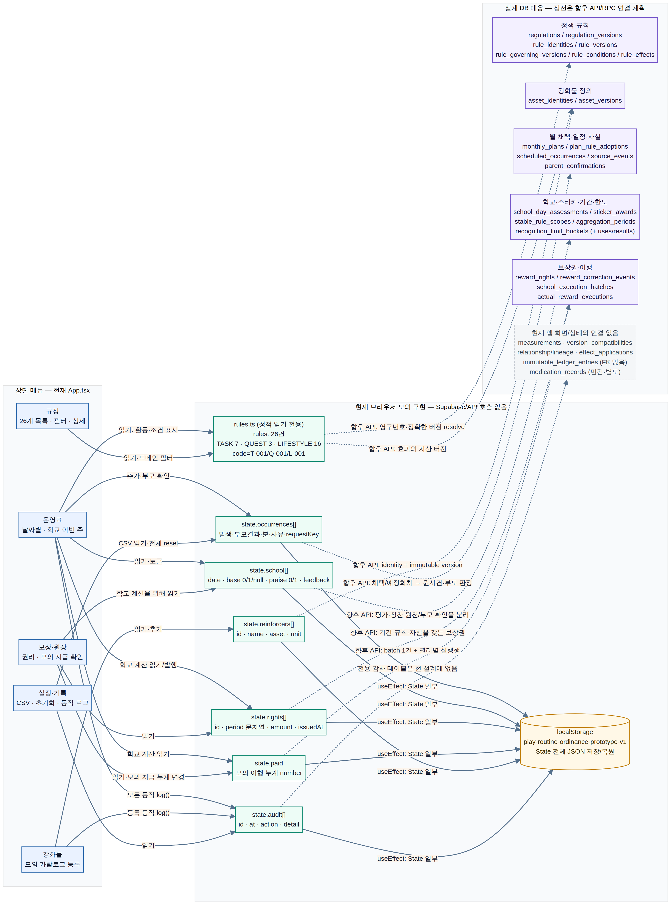
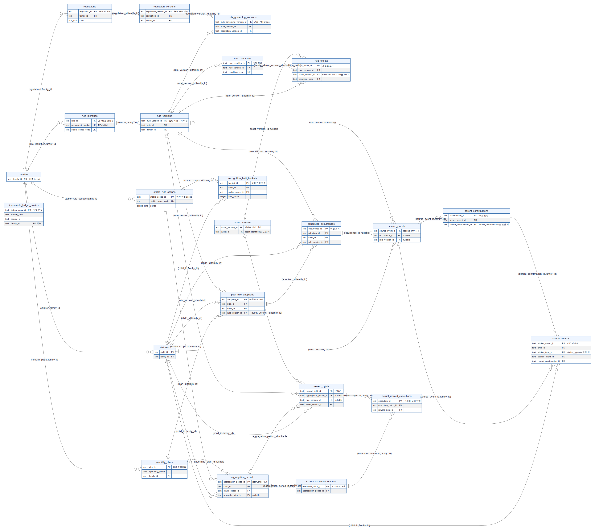

# 관계 분리는 유지하되, 운영 연결 전에 승인·규칙 실행·가족 안 자녀 정합성을 보강해야 한다

이번 `pr_design` 스키마는 다른 학부모로 확장할 수 있는 방향이다. 가족 식별자, 규정과 규칙의 버전, 월별 채택, 원사건과 부모 판정, 보상권과 실제 이행을 분리한 점은 유지하는 것이 맞다. 다만 **38개 테이블과 26개 규칙이 있다는 것과, 26개 규칙이 실제 운영에서 모두 실행된다는 것은 다르다.** 현재 웹 화면은 정적 규칙과 브라우저 모의 상태를 연결하며, SQL은 제한된 생활습관·학교 계산을 격리 검증한 설계다. [1] [2] [3]

실제 **Grok `grok-4.7`**에 이 스키마와 메뉴 코드를 보내 검토했다. Grok도 가족별 정본 관계는 채택하되, 운영 연결 전 권한·동시성·자녀 정합성·읽기 API를 보강해야 한다고 판단했다. [Grok 실제 검토 원문](Grok-Schema-Multiuser-Review-20261017.md)은 그대로 보존했다. 아래 내용은 그 의견에 Manus의 특정 코드 확인을 합친 판단이다. 기존 운영 DB·사이트·Git 파일은 이번 검토에서 변경하지 않았다.

## 1. 유지할 관계

부모가 현재 한 명이라고 `family_id`나 가족 복합 외래키를 없애지 않는다. `(id, family_id)` 참조는 다른 가족의 자녀·규칙·자산이 연결되는 것을 막는 토대다. 같은 사용자가 두 기기에서 접근하고, 자녀 프런트가 별도로 기록하기 때문에 사용자 한 명이어도 동시성은 존재한다. [1]

상위 규정과 Task·Quest·Lifestyle 하위규정은 `regulation_versions`로 버전을 남기고, 개별 시행규칙은 `rule_identities → rule_versions`로 이어진다. `rule_governing_versions`는 각 규칙이 어떤 하위규정 버전을 근거로 하는지 연결한다. 10월 계획은 규칙 전문을 복사하지 않고 `plan_rule_adoptions`에서 자녀에게 정확한 규칙 버전을 채택한다. 다음 달에도 영구번호는 유지하고, 변경한 규칙만 새 버전을 참조한다. [1]

한 조건의 두 보상은 `rule_conditions` 한 행에 `rule_effects` 두 행을 연결한다. 예를 들어 Q-001은 `PASS` 조건 하나에 미디어 300분과 현금 50,000원을 연결한다. 두 자산을 받더라도 달성 인정 횟수를 두 번 소비하지 않는다. **두 번째 보상이 없으면 효과 행을 하나만 두면 된다.** [4]

학교 T-007은 기본 0/1과 별도 칭찬 스티커를 구분한다. 주간 목표총액과 이미 발행한 권리를 비교해 차액만 발행하고, 지급은 각 보상권 잔량에 나눠 기록한다. 생활 한도는 계획이나 규칙 버전이 아니라 가족·자녀·안정된 범위·업무일에 묶는다. 규칙을 개정하거나 월 계획을 바꿨다는 이유로 같은 날 한도가 다시 생기면 안 된다. [1]

## 2. 운영 연결 전 가장 먼저 고칠 부분

### 승인 조건은 기본 거절이어야 한다

Grok가 지적한 함수 실행권과 인증 경계는 운영 전 필수 항목이다. 현재 SQL은 테이블·시퀀스의 `PUBLIC` 권한을 회수하지만, 함수 실행권 회수와 앱 역할 부여를 완결하지 않았다. `SECURITY DEFINER` 함수는 호출자보다 큰 권한으로 실행될 수 있다. 따라서 공개 실행권을 회수하고 의도한 진입 RPC만 허용하며, JWT 서명·발급자·대상을 검증한 서버가 요청별 인증 문맥을 설정해야 한다. 내부 권한 보조함수는 별도 비공개 영역에 두는 것이 낫다. 읽기 RLS나 RPC는 그 후 역할별로 검증한다. [1] [5]

**Manus가 추가로 확인한 구체적 결함은 미설정 `test_mode`의 NULL 처리다.** 새로운 격리 엔진에서 `test_mode_enabled()`는 설정이 없을 때 `NULL`을 반환했다. 초안 거절 조건 `NOT (false OR (NULL AND true))`도 `NULL`이다. PL/pgSQL의 `IF`는 조건이 참일 때만 실행되므로, 단순히 이 조건을 쓰는 것은 기본 거절이 아니다. 실제 인증 전체 우회를 시험했다는 뜻은 아니지만, 승인 분기의 실패-닫힘 처리는 먼저 보강해야 한다.

```sql
-- 제안일 뿐 이번 검토에서 기존 스키마를 수정하지 않았다.
SELECT COALESCE(current_setting('pr_design.test_mode', true) = 'on', false);
```

더 좋은 운영 구성은 테스트 우회 경로 자체를 시험 전용 설치로 분리하는 것이다. 일반 앱 사용자가 바꿀 수 있는 설정값을 승인 권한으로 삼지 않는다. 이 특정 반례는 `null-test-mode-evidence.json`에 보존했다.

### 같은 가족의 다른 자녀도 잘못 연결될 수 있다

가족 복합 FK는 가족 간 혼합을 막지만, 같은 가족의 자녀 A 사건이 자녀 B 회차를 참조하는 것까지 막지는 않는다. 현재 사건과 학교 평가의 회차 참조는 `(occurrence_id, family_id)`이고 별도의 `child_id`가 있다. 회차 참조에 자녀까지 포함한 유일키·FK를 쓰거나, 서버에서 회차의 자녀·규칙 버전·범위 일치를 강제해야 한다. 둘째 자녀를 추가하기 전 필요한 무결성 보강이다. [1]

부모는 전체 가족 운영표를 보되, 자녀는 자신의 회차·설명 가능한 결과만 보고, 보호자는 상태 전용 요약만 읽게 한다. `medication_records`는 일반 보호자 상태와 별도 권한으로 처리한다. 현재 `pr_design`에는 이러한 자녀·보호자 읽기 API나 RLS가 완성돼 있지 않다. 기존 운영 앱의 권한을 이 새 설계에 자동으로 있다고 간주해서는 안 된다. [1] [5]

### 26개 목록과 실행 가능한 규칙을 구별해야 한다

Grok가 의심한 L-001은 실제 원본 seed에서 **조건 행이 두 개**였다. `PASS` 외에 `OPTIONAL_NONE_SELECTED`라는 빈 선택용 조건과 NULL 스티커 효과가 있다. 그런데 생활 인정 함수는 단일 조건만 실행한다. 따라서 원본 L-001을 그대로 실행하는 것과, 단일 조건 시험용 규칙으로 검증하는 것은 다르다. 빈 두 번째 보상을 표현하려고 가짜 조건을 만들지 말고, 두 번째 효과를 생략하는 방식으로 정리해야 한다. [1] [4]

또한 seed의 안정 범위는 L-001과 학교만 준비돼 있다. 다른 생활습관을 실제 운영표에 붙이려면 해당 범위를 준비해야 한다. Task·Quest의 임의 조건 전체를 실행하는 엔진은 아직 없다. **26개 규칙을 보여주는 프로토타입은 완성됐지만, 모든 규칙의 수행·정산 엔진은 완성된 상태가 아니다.**

원본 seed 조건은 격리 조회에서 21행이었다. 기존 39개 검사의 결과에 나온 22행은 추가 fixture가 포함된 실행 상태로 읽어야 한다. Grok는 이 차이를 불확실하다고 표시했으며, 이번 검토에서 원본 seed 수와 L-001의 두 조건만 확인했다. 검증 개수 자체를 변경하거나 모든 26개 실행을 새로 시험했다고 주장하지 않는다.

## 3. 여러 부모·기기에서 필요한 동시성 보강

생활 인정은 키 충돌 후 재조회하는 경로가 있으나, 패널티 기록과 이행 배치는 같은 키로 동시에 첫 요청이 오면 정상 재전송 결과 대신 유일 제약 오류가 날 수 있다. 없는 행에는 `FOR UPDATE`로 잠글 행이 없다. 충돌 후 재조회와 요청 내용 비교, 또는 요청키 단위 잠금으로 같은 결과를 반환하게 해야 한다. 기간·보상권 잠금은 계속 유지한다. [1]

학교 판정, 정정, 마감, 이행은 같은 기간·권리의 일관된 잠금 순서로 처리해야 한다. 특히 정정 행을 넣는 경로에는 이행 트리거의 잔량 검사만으로 충분하지 않다. 이미 지급한 금액보다 권리를 낮추는 정정은 기존 정책대로 검토 상태로 보내고 자동 회수하지 않는다. 이 판단은 코드 독해이며, 실제 PostgreSQL 다중 연결 시험은 아직 하지 않았다.

일괄 확인은 부모 클릭 한 번을 서버의 여러 원사건·판정 기록으로 저장하게 만들면 된다. 표의 여러 셀을 덮어써 이력을 없애거나, 모든 가족이 하나의 전역 잠금을 기다리게 만들 필요는 없다.

## 4. 확장할 때 실제로 필요한 성능 최적화

현재 문제는 테이블 수보다 **조회 경로와 규칙의 정본**이다. 이미 PK·UNIQUE가 만든 인덱스를 반복해서 추가하지 않는다. 생활 한도, 학교 평가, 예정 회차에는 가족·자녀·범위로 시작하는 유일키가 있으므로 그 경로를 먼저 활용한다. 반면 아래 경로는 기존 키로 충분히 대체되지 않는다. 이들은 조회량이 늘어날 때 실행계획을 보고 채택할 후보다. [1] [6]

```sql
-- 최적화 후보: 운영에 적용하거나 속도를 측정한 SQL이 아니다.
CREATE INDEX ON pr_design.reward_rights (family_id, aggregation_period_id);
CREATE INDEX ON pr_design.reward_correction_events (family_id, reward_right_id);
CREATE INDEX ON pr_design.parent_confirmations (family_id, source_event_id);
CREATE INDEX ON pr_design.source_events (family_id, child_id, occurred_at);
```

복합 B-tree는 선두 열의 동등 조건과 다음 범위 조건에 맞춰 고른다. “family_id를 모든 인덱스에 붙이면 무조건 빨라진다”거나 “선두가 아닌 열은 절대 이용하지 못한다”는 식으로 단정하지 않는다. 실제 PostgreSQL 버전·행 분포·실행계획에 따라 판단한다. [6]

운영표는 날짜·자녀 범위의 읽기 모델, 규정은 계획이 채택한 규칙 목록, 보상은 기간별 권리·이행 요약처럼 화면별 조회를 나누는 것이 좋다. 38개 테이블을 메뉴 진입 때마다 모두 내려받지 않는다. 규정 목록 26건은 한 번에 읽어도 되지만, 늘어나는 사건·감사 이력에는 커서와 페이지 크기를 둔다. UI 캐시 키는 최소한 사용자·가족·자녀·업무일/기간·권한 범위를 포함하고, 로그아웃·가족 전환 때 비운다. 캐시 키는 권한 검증의 대체물이 아니다.

학교 금액도 장차 모든 가족에 10,000/15,000원을 강제하면 안 된다. 현재 함수의 `CASE`는 난영님 학교 규칙에 맞춘 전용 계산이다. 다른 가족으로 확대할 때는 각 가족이 채택한 규칙 버전의 조건과 효과에서 구간·금액을 읽어야 한다. **난영님의 확정 구간과 금액은 그대로 유지한다.** 생활 `positive_minutes`와 효과 수량 역시 동일 값을 중복 정의하는 문제가 생기지 않게 정본과 파생 표시값을 구분한다. [1]

샤딩, 가족별 스키마, 그래프 DB, 대량 파티셔닝은 지금 하지 않는 것이 맞다. 실제 사건 누적량과 조회 지연을 측정한 뒤 결정한다. 이번 검토로 지원 가능한 가족 수나 처리 속도 배율을 산정할 근거는 없다.

## 5. 메뉴와 26개 규칙은 현재 이렇게 연결된다

화면의 공통 출발점은 `rules.ts`의 T-001~T-007, Q-001~Q-003, L-001~L-016이다. 번호로 행과 설명을 찾고, `App.tsx`가 하나의 로컬 상태를 다섯 메뉴에 나눠 보여준다. **메뉴 이동은 데이터를 복사하는 것이 아니라 같은 규칙과 상태의 다른 보기를 여는 방식이다.** [2] [3]

`운영표`는 날짜별 `occurrences`를 규칙번호로 연결하고 부모 확인·한도 표시를 처리한다. T-007을 선택하면 학교 주간 보기로 이동한다. 학교 계산은 `school[]`만 집계하므로 다른 생활습관 스티커가 섞이지 않는다. Q-001의 두 자산 보상은 규정 설명과 SQL 효과 관계에 있지만, 프런트에서 두 자산을 실제 발행하는 기능으로 연결된 것은 아니다.

`규정`은 같은 26개 규칙의 종류·조건·보상을 읽는다. `보상·원장`은 학교 `rights[]`와 모의 `paid` 숫자를 읽는다. 운영표에서 발행한 권리가 이 화면에도 보이는 것은 공통 로컬 상태를 쓰기 때문이다. 다만 DB의 권리별 이행 행·실제 원장과 연결되지는 않았다. `강화물`은 반복 사용 목록을 로컬에 추가하며 SQL의 불변 `asset_versions`와 동기화되지 않는다. `설정·기록`은 모의 감사 로그와 CSV를 다루며, 실제 가족 설정·복약 자료를 관리하지 않는다. [2]

운영 연결 후에는 화면 규칙번호를 서버가 다음처럼 해석해야 한다. 번호만으로 규칙 버전이나 가족을 결정하지 않는다.

```text
로그인 사용자 → 허용 가족·자녀
  → 월 계획의 채택(adoption)
  → 영구 규칙번호(permanent_number)와 규칙 정체성(rule_id)
  → 정확한 규칙 버전(rule_version_id)
  → 해당 버전의 조건·효과·강화물 버전
  → 예정 회차 또는 실제 사건
  → 부모 판정 / 기간·한도
  → 보상권 / 권리별 이행
```

[메뉴·데이터 연결도](Menu-Data-Link.png)의 실선은 현재 브라우저 모의 연결, 점선은 향후 API/RPC 대응이다. **점선은 FK가 아니다.** [핵심 ERD](Core-ERD.png)는 38개 중 핵심 23개 테이블의 실제 FK를 보여준다. 생략한 상세 관계는 `menu-erd-notes.md`에 적었다.





`immutable_ledger_entries`는 ERD에서 고립돼 있다. 현재 자녀·자산·기간·원천 FK가 없는 append-only 모형이기 때문이다. 실정산을 연결하기 전 이 관계를 보강해야 한다. 화면의 “원장”이라는 메뉴 이름을 실제 정산 구현의 근거로 보면 안 된다.

## References

[1]: https://github.com/maenglion/play-routine/blob/7f008e7418bf6901c73160f5a34764cfeaf810a0/prototypes/regulation-grid-20261017/database/schema.sql "검토 대상 신규 DB 스키마"
[2]: https://github.com/maenglion/play-routine/blob/7f008e7418bf6901c73160f5a34764cfeaf810a0/prototypes/regulation-grid-20261017/prototype/src/App.tsx "상단 메뉴와 모의 공통 상태 구현"
[3]: https://github.com/maenglion/play-routine/blob/7f008e7418bf6901c73160f5a34764cfeaf810a0/prototypes/regulation-grid-20261017/prototype/src/rules.ts "26개 규칙의 정적 화면 데이터"
[4]: https://github.com/maenglion/play-routine/blob/7f008e7418bf6901c73160f5a34764cfeaf810a0/prototypes/regulation-grid-20261017/database/seed.sql "시행규칙·조건·효과·범위 seed"
[5]: https://supabase.com/docs/guides/database/postgres/row-level-security "Supabase 권한·함수·RLS 공식 지침"
[6]: https://www.postgresql.org/docs/current/indexes-multicolumn.html "PostgreSQL 복합 인덱스의 적용 기준"
